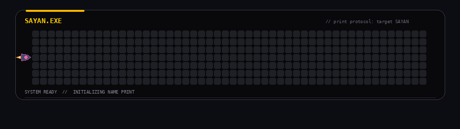

# SAYAN MAHATA · `@sayanm24`

  
  
  

**BUILD · DESIGN · PROMPT · CREATE**

---

## 🌴 About Me

Hey, I'm **Sayan** — a builder who enjoys combining code, design, and creative technology.

- 🧠 **Prompt Engineer** — exploring prompt design and AI-assisted workflows.
- 🎨 **UI/UX Enthusiast** — interested in intuitive interfaces, visual systems, and interaction design.
- 💻 **Full-Stack Developer** — building web experiences from interface to backend.
- 🎮 Interested in gaming, animation, and playful digital experiences.
- 🚀 I like turning ambitious ideas into useful products and learning by shipping.

---

## 🏙️ Featured Projects

<table>
  <tr>
    <td width="33%" valign="top">
      <h3>🌦️ EUTOPIA Weather</h3>
      
A live-adaptive weather experience where the atmosphere, colours, animations, forecasts, radar, and mood-based music respond to weather conditions.

      
<a href="https://github.com/sayanm24/Eutopia-weather">View source →</a>

    </td>
    <td width="33%" valign="top">
      <h3>🚀 SIH</h3>
      
A hackathon project with a public demo and a web-app codebase built with a Vite frontend and Supabase components.

      
<a href="https://github.com/sayanm24/SIH">Source code</a> · <a href="https://sih-nine-olive.vercel.app/">Live demo</a>

    </td>
    <td width="33%" valign="top">
      <h3>🧑‍🚀 Portfolio</h3>
      
A personal portfolio experiment using HTML, CSS, and JavaScript, including a 3D character component.

      
<a href="https://github.com/sayanm24/Portfolio">Source code</a> · <a href="https://portfolio-jet-three-16.vercel.app/">Live site</a>

    </td>
  </tr>
</table>

  

---

## 🧰 Tech Stack & Creative Tools

  <strong>Languages & Web</strong> 
  

  <strong>Backend, Data & Tools</strong> 
  

  <strong>Design & 3D</strong> 
  

---

## 📊 GitHub Dashboard

  
  
   
  
   
  

---

## 🔫 SAYAN.EXE

**[ SYSTEM ONLINE ] — SAYAN.EXE**

---

## ⚡ Currently

- Building and refining full-stack web experiences.
- Exploring prompt engineering and AI-assisted workflows.
- Practising UI/UX through real interfaces and prototypes.
- Learning, experimenting, and documenting the journey.

## 🤝 Connect

  
  

### 🌅 THINK BOLDLY · DESIGN WITH INTENT · BUILD THE FUTURE

