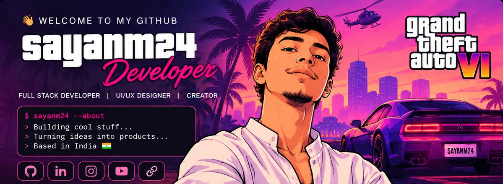

<!-- Profile README for github.com/sayanm24 -->

  

<h1 align="center">Hey, I'm Sayan Mahata 👋</h1>
<h3 align="center">Full-Stack Developer · UI/UX Enthusiast · Builder</h3>

  
  
  

---

## 🏝️ About me

- 🇮🇳 Based in India
- 💻 Interested in building full-stack products and polished user experiences
- 🎨 Exploring UI/UX, creative coding, animation and game development
- 🚀 I enjoy turning ambitious ideas into working projects
- 🌱 Always learning, experimenting and shipping

## 🧰 Tech stack

  

## 🚀 Featured projects

| Project | What I'm building |
|---|---|
| **EUTOPIA** | A Gen-Z experience for trends, campus communities and live, mood-aware interfaces. |
| **Healix** | A health companion concept focused on making health information easier to understand. |
| **ASTRA** | An Indian mythology-inspired Roblox action RPG. |
| **The 1% Challenge** | A Roblox progression game built around challenges and rewards. |

> Project descriptions reflect my current project work. Visit my [repositories](https://github.com/sayanm24?tab=repositories) for the latest public code.

## 📊 GitHub dashboard

  
  

  

  

## 🌐 Find me

  
  

<i>“Build boldly. Learn constantly. Ship something real.”</i>

