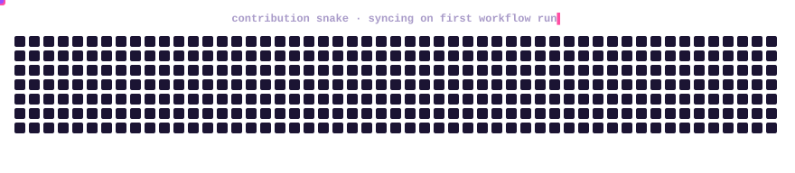

<!-- ═══════════════════════ 1. BANNER ═══════════════════════ -->

  

<!-- ═══════════════ 2. PLAYER CARD + SKILLS ORBIT ═══════════════ -->
<table width="100%"><tr>
<td width="33%" align="center"></td>
<td width="67%" align="center"></td>
</tr></table>

<!-- ═══════════════════════ 3. CONNECT ═══════════════════════ -->

  
  
  <!-- Fill in your links, then remove these comment markers:
  
  
  
  
  -->
  

<!-- ═══════════════════════ 4. PROJECTS ═══════════════════════ -->

   
  
    

<table width="100%">
<tr>
<td width="50%"></td>
<td width="50%"></td>
</tr>
<tr>
<td width="50%"></td>
<td width="50%"></td>
</tr>
</table>

<!-- ═══════════ 5. STATS (auto-refreshed daily by .github/workflows/stats.yml) ═══════════ -->
<table width="100%">
<tr>
<td width="50%"></td>
<td width="50%"></td>
</tr>
</table>

  

<!-- ═══════════ 6. SAYAN.EXE — the snake eats the board and spells the name ═══════════ -->

   
  
    
  

<!-- ═══════════════════════ 7. OUTRO ═══════════════════════ -->

   
  
   
  ~ Sayan Mahata

